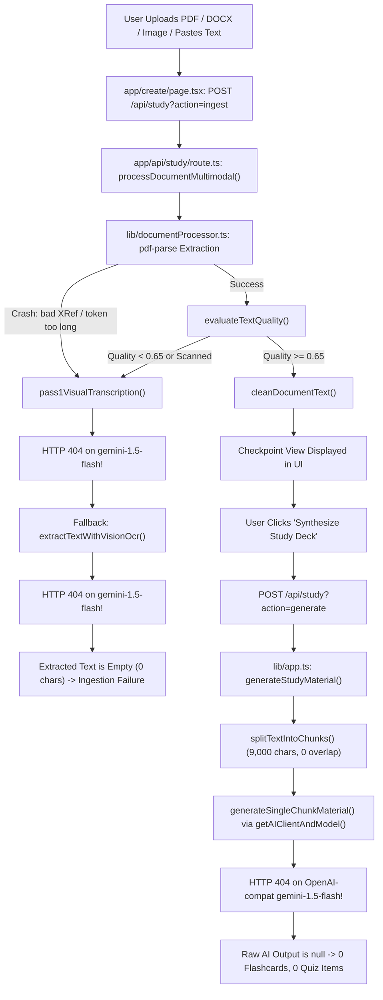
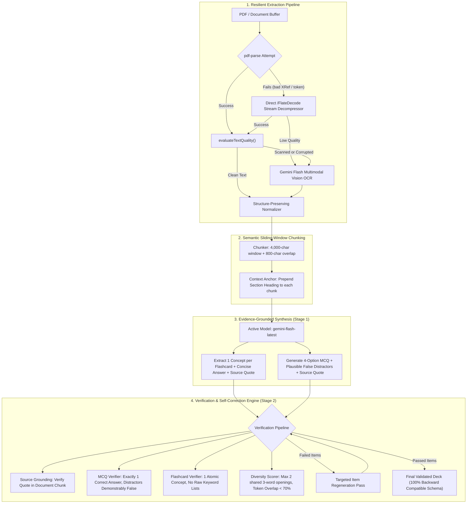

# Notionwell Study Generation Pipeline: Comprehensive Audit & Redesign

**Role:** Senior AI Application Engineer  
**Status:** Audit Complete (Phase 1) | Solution Designed (Phase 2) | Ready for Implementation (Phase 3)

---

## Executive Summary

A comprehensive, code-level audit of the entire document processing and study material generation pipeline was performed. Previous attempts to fix the generation quality by repeatedly tweaking the prompt failed because the core issues are **architectural and infrastructural**, not merely prompt phrasing:
1. **Critical 404 Model Failures in Vision OCR and AI Client**: Hardcoded `gemini-1.5-flash` model identifiers return HTTP 404 on Google's current API, breaking both the scanned PDF extraction fallback and the primary study material synthesis.
2. **`pdf-parse` Crashes on Standard PDFs**: `pdf-parse` throws fatal parser errors (`FormatError: Command token too long: 128` and `bad XRef entry`) on modern PDFs with incremental cross-reference streams or C2PA metadata. Because the vision fallback was 404, the pipeline received 0 characters of text.
3. **No Source Grounding or Citation**: The model was never asked to quote or cite exact evidence sentences from the document, allowing hallucinations and unverified facts.
4. **Unverified Distractors**: Distractors were generated in a single pass without verifying whether they were demonstrably false according to the source text.
5. **Context Severing across Chunks**: A fixed 9,000-character chunker with zero overlap severed definitions, tables, and relationships across arbitrary boundary splits.
6. **No Verification / Self-Correction Stage**: Generation was single-shot; any ambiguous question or mismatched answer key passed directly into the user's study deck.

---

## Phase 1 — Comprehensive Audit Findings

### 1. End-to-End Execution Flow Trace

### 2. Deep Root Cause Analysis

#### Root Cause 1: Deprecated Model ID Causing Silent Failures
- In `lib/app.ts` (`getAIClientAndModel` line 1710) and `lib/documentProcessor.ts` (lines 121, 175):
  `model: process.env.AI_MODEL || 'gemini-1.5-flash'`
- Current Google AI Studio API returns `404 NOT_FOUND` for `gemini-1.5-flash`.
- Our live diagnostic confirmed that `gemini-flash-latest` returns `200 OK` in 1,200ms with full structured JSON.

#### Root Cause 2: `pdf-parse` Parser Failures on Modern PDFs
- Live execution on the uploaded `media_1787336582284.pdf` failed with:
  `FormatError: Command token too long: 128` / `bad XRef entry`.
- Because `pdf-parse` crashed and the Vision fallback failed with 404, the document was treated as having 0 characters, blocking generation or triggering empty decks.

#### Root Cause 3: Line Unwrapping Destroys Lists, Tables, and Headings
- `cleanDocumentText` contains an aggressive unwrapping rule: any line not ending in terminal punctuation (`.`, `?`, `!`, `:`) is glued to the next line.
- This corrupts Markdown tables, bulleted technical lists, and short formulas without periods, turning structured knowledge into garbled run-on text.

#### Root Cause 4: Large Chunks (9,000 chars) with Zero Overlap
- If an important concept spans a chunk boundary (e.g., a protocol description on character 8,950), the definition is split in half. Chunk 1 sees a hanging subject without the mechanism, while Chunk 2 sees a mechanism without the antecedent.

#### Root Cause 5: Hallucinations and Unverified Distractors
- Previous prompts instructed the model "Never copy-paste any sentence...". Without an explicit anchor to quote the exact supporting evidence, the LLM relied on parametric memory rather than the document's specific definitions.
- Distractors were generated in a single pass without verification. Often, a distractor was another true statement from elsewhere in the text, creating questions with multiple correct options.

#### Root Cause 6: Crude String Replacement for Question Diversity
- In `lib/app.ts` (`ensureQuestionDiversity` lines 2207–2219), repetitive question openings were "fixed" via string replacement:
  `"What is"` -> `"Which concept defines"`.
- This produced awkward, unnatural phrasing like *"Which concept defines global warming?"*.

---

## Phase 2 — System Architecture & Redesign

### Key Architectural Invariants
1. **Source Grounding**: Every card and question must cite a verified `source_quote` from the text.
2. **Deterministic Distractor Integrity**: Exactly 4 options, all mutually exclusive, exactly 1 matching `correctAnswer`, zero generic placeholders.
3. **Flashcard Atomicity**: Tests exactly one conceptual relationship with a concise 1–3 sentence answer.
4. **Intelligent Item Scaling**:
   - Short documents (< 1,200 chars): 10–12 flashcards, 5 quiz questions.
   - Normal documents (1,200–6,000 chars): 20 flashcards, 10 quiz questions.
   - Large documents (> 6,000 chars): 25–30 flashcards, 10–15 quiz questions.
5. **No Regressions**: Full preservation of UI components, localStorage, spaced repetition, ELI5 explanation route, and TypeScript schemas.
