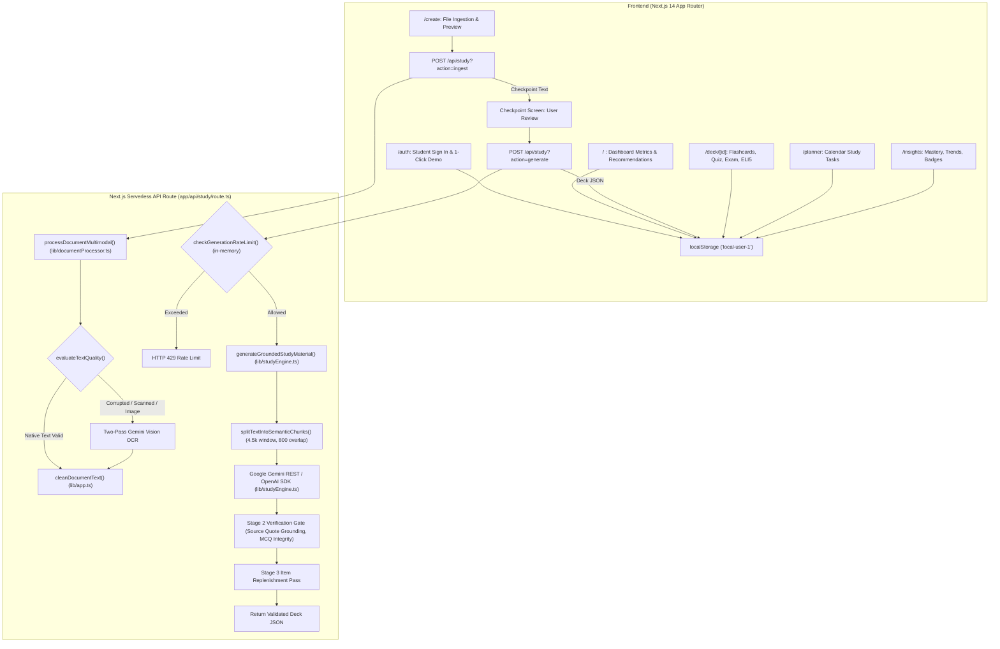
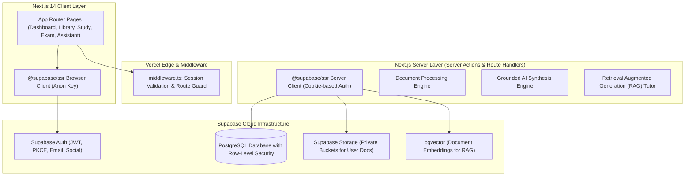
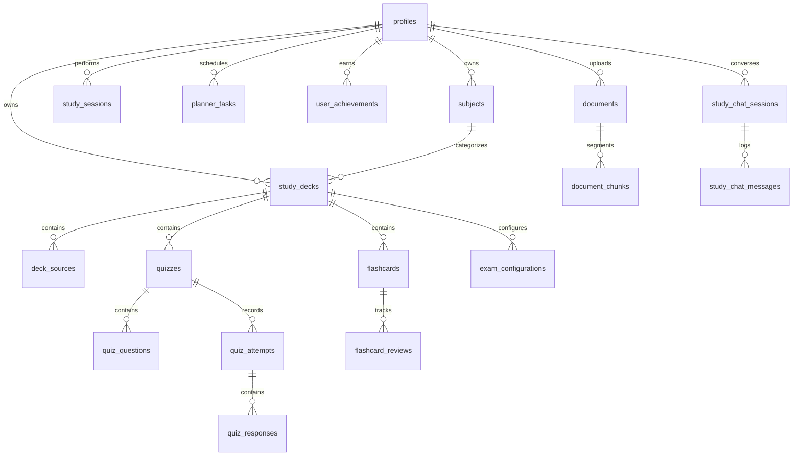

# NOTIONWELL 2.0 — COMPLETE TECHNICAL AUDIT & ARCHITECTURAL BLUEPRINT

**Document:** `docs/NOTIONWELL_TECHNICAL_AUDIT.md`  
**System:** Notionwell — Turn Notes Into Knowledge  
**Repository:** `https://github.com/Sam18-prog/Notionwell.git`  
**Production URL:** `https://notionwell.vercel.app/`  
**Framework:** Next.js 14.2.35 (App Router) | React 18 | TypeScript | Tailwind CSS  
**Auditor:** Senior Software Architect & Full-Stack AI Engineer  
**Date:** November 2026  
**Status:** Audit Complete | Phase 0 Milestone  

---

## 1. Executive Summary

Notionwell is an active-recall study platform deployed on Vercel designed to synthesize flashcards, quizzes, and revision schedules from student study notes (PDFs, DOCX, TXT, and scanned images). 

This comprehensive Phase 0 audit analyzes the entire codebase to establish a baseline for **Notionwell 2.0**. The existing system features a rich, responsive frontend interface and sophisticated pedagogical generation guardrails, but operates almost entirely within client-side browser `localStorage` with a hardcoded single user identifier (`local-user-1`). 

### Core Audit Verdict:
1. **Frontend & UX**: Highly responsive, thoughtfully designed, and feature-rich (deck library, subject hierarchies, flashcard flipping with SuperMemo SM-2, multiple-choice quizzes, 5-minute mock exam tab, calendar study planner, 7-day study stopwatch analytics, and gamification badges).
2. **Pedagogical Generation Quality**: Substantially improved in recent iterations with source quote grounding checks, strict rejection of generic robotic templates (e.g., *"What does the study text state regarding..."*), option uniqueness enforcement, and multi-chunk scaling in `lib/studyEngine.ts`.
3. **Storage & Multi-User Architecture**: **Critical Technical Debt**. All persistent state—including user accounts, password hashes, study decks, review logs, and raw base64 uploaded files—is stored in browser `localStorage`. There is no multi-user isolation, no cross-device sync, and storing files in `localStorage` rapidly hits browser quota limits (~5MB).
4. **Security & API Vulnerabilities**: The primary generation endpoint (`/api/study`) is completely unauthenticated and uses an in-memory IP rate limiter that resets across Vercel serverless cold starts.

Transforming Notionwell into a reliable, enterprise-grade AI learning SaaS requires migrating from local storage to a normalized Supabase PostgreSQL backend with Row-Level Security (RLS), Supabase Auth, Supabase Storage for private document files, and vector embeddings (`pgvector`) for document-grounded AI tutoring.

---

## 2. End-to-End Execution Flow Trace

---

## 3. Feature Inventory & Implementation Status

Every feature in the application has been inspected at the code level and categorized into one of five statuses:
- **Working**: Fully operational, verified against runtime requirements.
- **Partially working**: Functional in UI, but limited by architectural constraints (e.g. `localStorage`, lack of persistence).
- **Broken**: Produces errors, contains invalid configurations, or fails under expected load.
- **Missing**: Referenced in UI or required for Notionwell 2.0 but not yet implemented.
- **Needs verification**: Requires external service/model verification under real load.

| Feature Area | Specific Capability | File Path(s) | Status | Detailed Finding |
| :--- | :--- | :--- | :--- | :--- |
| **Authentication** | Email/Password Registration | `app/auth/page.tsx`, `lib/app.ts:1533` | **Partially working** | Registers account client-side into `localStorage` (`notionwell_account_v1`); only supports 1 account per browser; no server session cookies. |
| **Authentication** | Student Sign In | `app/auth/page.tsx`, `lib/app.ts:1593` | **Partially working** | Compares client-side SHA-256 hash against localStorage; no server authentication. |
| **Authentication** | 1-Click Demo Login | `app/auth/page.tsx`, `lib/app.ts:1636` | **Working** | Auto-generates local demo account `demo@notionwell.ai` and sets session flag. |
| **Authentication** | Route Protection | `app/page.tsx`, `app/deck/[id]/page.tsx`, etc. | **Partially working** | Client-only `useEffect` redirect; zero Next.js server middleware; API routes remain completely unprotected. |
| **Authentication** | Password Reset | `app/auth/page.tsx` | **Missing** | No password reset or recovery workflow exists. |
| **Persistence** | Subject Folders | `lib/app.ts:390`, `lib/storage.ts:16` | **Partially working** | Fully functional via `notionwell_subjects_v1` in `localStorage`; lost across devices or cache clears. |
| **Persistence** | Study Decks & Cards | `lib/app.ts:430`, `lib/storage.ts:22` | **Partially working** | Stored in `notionwell_decks_v1`; no backend database or cloud backup. |
| **Persistence** | Multi-Source Documents | `lib/app.ts:440`, `components/ManageSourcesModal.tsx` | **Broken** | Stores base64 data URLs of entire files into `localStorage` (`notionwell_sources_v1`), rapidly exceeding the browser 5MB limit. |
| **Persistence** | LocalStorage Migration | `lib/app.ts:340` | **Partially working** | Legacy migration from old keys (`studypack_*` to `notionwell_*`); no cloud database migration yet. |
| **Document Ingestion** | Standard PDF Parsing | `lib/documentProcessor.ts:334` | **Working** | Uses `pdf-parse`; captures native digital text streams. |
| **Document Ingestion** | Scanned / Corrupted PDF | `lib/documentProcessor.ts:246` | **Working** | Stream decompression fallback (`extractRawPdfStreamFallback`) recovers raw text from broken xref streams. |
| **Document Ingestion** | Vision OCR Fallback | `lib/documentProcessor.ts:121` | **Needs verification** | Uses Gemini Vision REST API. Uses model list `[process.env.AI_MODEL || 'gemini-3.5-flash', 'gemini-flash-lite-latest', 'gemini-flash-latest']`. Note: `gemini-3.5-flash` is an invalid identifier. |
| **Document Ingestion** | DOCX Document Extraction | `lib/documentProcessor.ts:348` | **Partially working** | Uses `mammoth.extractRawText`; extracts plain text but strips all table structures, lists, and headings. |
| **Document Ingestion** | Image Notes (JPG/PNG/WEBP) | `lib/documentProcessor.ts:360` | **Working** | Routes directly to Multimodal Vision OCR and Canvas image compression. |
| **Document Ingestion** | Text Pre-cleaning & TOC Filter | `lib/app.ts:1877` | **Working** | Robust regex cleans headers, footers, TOC dot leaders, question number prefixes, and unifies line wraps. |
| **Generation Engine** | Semantic Chunking | `lib/studyEngine.ts:162` | **Working** | 4,500 character sliding window with 800 character overlap preserves context across section boundaries. |
| **Generation Engine** | Dynamic Item Count Scaling | `lib/studyEngine.ts:78` | **Working** | Dynamically scales output (12 FC/5 Quiz for short excerpts, 20 FC/10 Quiz for standard, 25-30 FC/12-15 Quiz for large docs). |
| **Generation Engine** | Source Quote Grounding | `lib/studyEngine.ts:218` | **Partially working** | Enforces `source_quote` in AI drafts and verifies grounding; however, the quote is discarded and not saved to the final deck! |
| **Generation Engine** | Distractor Verification | `lib/studyEngine.ts:278` | **Working** | Rejects identical options, placeholder distractors ("option A", "all of the above"), and ensures exactly 1 matching correct option. |
| **Generation Engine** | Anti-Robotic Question Filter | `lib/studyEngine.ts:24`, `102` | **Working** | Blocks 25+ robotic phrases (`"What does the study text state regarding..."`, `"According to the text..."`). |
| **Generation Engine** | ELI5 Simplification | `app/api/study/route.ts:118`, `lib/app.ts:2783` | **Working** | Real-time AI explanation simplified for a 5-year-old with localStorage caching (`notionwell_eli5_v1`). |
| **Study Experience** | Flashcard Active Recall | `app/deck/[id]/page.tsx:77` | **Working** | Smooth 3D card flipping, keyboard navigation, question/answer rendering. |
| **Study Experience** | SM-2 Spaced Repetition | `lib/app.ts:180` | **Working** | Calculates easiness factor, repetition intervals, next review dates, and mastery level progression. |
| **Study Experience** | Multiple-Choice Quiz | `app/deck/[id]/page.tsx:96` | **Working** | Interactive 4-choice questions, instant feedback, score calculation, explanation display. |
| **Study Experience** | Mock Exam Mode | `app/deck/[id]/page.tsx:104` | **Partially working** | Hardcoded 5-minute timer resets on page refresh; saves results as generic flashcard session logs rather than exam attempts. |
| **Study Experience** | Anki CSV & PDF Export | `lib/exportUtils.ts`, `lib/pdf.ts` | **Working** | Downloads formatted PDF study sheet or Anki-compatible CSV deck. |
| **Analytics & Gamification** | Study Stopwatch & Inactivity | `lib/timer.ts`, `components/Stopwatch.tsx` | **Partially working** | Tracks active time with 15-minute idle pause; timer resets on browser tab refresh. |
| **Analytics & Gamification** | 7-Day Study Chart | `components/StudyTimeChart.tsx` | **Working** | Visualizes daily study seconds across the past 7 days. |
| **Analytics & Gamification** | Weak Topic Identification | `lib/app.ts:510`, `app/insights/page.tsx` | **Working** | Detects subtopics with >30% quiz error rate; provides 1-click drill sessions. |
| **Analytics & Gamification** | Achievement Badges | `lib/app.ts:120`, `components/BadgeToast.tsx` | **Working** | Unlocks 10 milestone badges (First Steps, Night Owl, Quiz Whiz, etc.) with animated toast. |
| **Study Planner** | Calendar Tasks | `app/planner/page.tsx` | **Working** | Monthly calendar, daily task completion toggles, subject & deck linking. |
| **AI Study Assistant** | RAG Document Chat Tutor | N/A | **Missing** | Notionwell 2.0 Phase 4 requirement; not yet implemented. |
| **Exam Simulation** | Timed Mock Exam Engine | N/A | **Missing** | Full mock exam suite with question palette, review flags, and persisted attempts (Phase 5). |
| **Advanced Tools** | AI Notes Summarizer | N/A | **Missing** | Notionwell 2.0 Phase 7 requirement. |
| **Advanced Tools** | AI Mind Map Generator | N/A | **Missing** | Notionwell 2.0 Phase 7 requirement. |
| **Advanced Tools** | Voice-Based AI Tutor | N/A | **Missing** | Notionwell 2.0 Phase 7 requirement. |

---

## 4. Comprehensive Audit Across 15 Focus Areas

### 4.1 Frontend Architecture
- **Framework**: Next.js 14.2.35 App Router with React 18 and TypeScript.
- **Styling**: Tailwind CSS with dark mode enabled via `.dark` class on `<html>`, coordinated through custom window events (`theme-change`).
- **Layout & Navigation**: Root layout (`app/layout.tsx`) renders a collapsible sidebar (`components/Sidebar.tsx`) and global achievement notification toast (`components/BadgeToast.tsx`).
- **State Management**: Local component state (`useState`), `useEffect` hooks for data synchronization, and custom DOM events (`auth-change`, `theme-change`, `study-timer-update`).
- **Architectural Debt**: High degree of code duplication between `app/page.tsx`, `app/insights/page.tsx`, and `app/deck/[id]/page.tsx` regarding metric aggregation and weak topic calculation.

### 4.2 Authentication and Session Management
- **Implementation**: Pure client-side simulation in `lib/app.ts` (`signupUser`, `loginUser`, `demoLoginUser`, `logoutUser`).
- **Security Deficit**:
  - Passwords hashed client-side with SHA-256 via Web Crypto API.
  - Plaintext account details and password hashes saved directly in `localStorage` under `notionwell_account_v1`.
  - Hardcoded user id `'local-user-1'` assigned to all sessions.
  - No server-side session cookies or JWT tokens.
  - Zero Next.js route middleware (`middleware.ts` is absent).
  - Anyone can access protected routes by disabling JavaScript or directly calling server APIs.

### 4.3 Current Storage and Persistence
- **Storage Layer**: Handled through `lib/storage.ts`, which acts as an abstraction re-exporting methods from `lib/app.ts`.
- **Primary Failure Point**: Browser `localStorage` has a strict quota (~5MB). When users upload documents or take pictures of notes, `components/ManageSourcesModal.tsx` and `app/create/page.tsx` store base64 file data URLs in `notionwell_sources_v1`. A single multi-page PDF or 2-3 compressed mobile photos instantly exhausts the quota, triggering uncaught `QuotaExceededError` exceptions and causing data loss.
- **Data Isolation**: Zero user data isolation; multiple users sharing a browser overwrite each other's decks.

### 4.4 Document Ingestion
- **Route**: `app/api/study/route.ts` handles `multipart/form-data` and JSON payloads.
- **Checkpoint Stage**: Successfully presents extracted text to the student before deck generation, allowing text corrections.
- **Bottlenecks**:
  - Hard 20,000 character limit (`MAX_DOCUMENT_CHARS` in `lib/rateLimit.ts`).
  - Documents over 15-20 pages are rejected entirely rather than processed in streaming chunks or asynchronous background jobs.

### 4.5 PDF, DOCX, and Image Extraction
- **PDF Extraction**:
  - `pdf-parse` handles standard text layers.
  - `extractRawPdfStreamFallback` (`lib/documentProcessor.ts`) decompresses `/FlateDecode` streams with Node.js `zlib` when `pdf-parse` fails on damaged XRef tables or C2PA metadata blocks.
- **DOCX Extraction**:
  - `mammoth.extractRawText` strips table structures, Markdown syntax, and numbered headings, flattening rich study documents into unformatted paragraphs.
- **Vision OCR**:
  - Successfully handles camera photos of lecture slides and handwritten notes using Gemini Multimodal Vision API.
  - Model list references non-existent model `gemini-3.5-flash`, which falls back to `gemini-flash-lite-latest` and `gemini-flash-latest`.

### 4.6 AI Model Configuration
- **Providers Supported**: Google Gemini (native REST & OpenAI-compatible), OpenAI, Groq, OpenRouter, and local base URLs (`lib/app.ts:1719`).
- **Defects**:
  - Hardcoded model identifier `gemini-3.5-flash` in `lib/app.ts:1732`, `lib/documentProcessor.ts:137`, and `lib/studyEngine.ts:350`. Google's current API does not recognize `gemini-3.5-flash`.
  - Lack of runtime Zod schema validation; reliance on `JSON.parse` with try/catch.
  - Rate-limit backoff lacks exponential jitter.

### 4.7 Flashcard Generation
- **Pipeline**: Two-stage generation in `lib/studyEngine.ts` (`generateGroundedStudyMaterial`).
- **Pedagogical Rules**:
  - Enforces `concept_tested`, `source_quote`, atomic 1-3 sentence answers.
  - Rejects blacklisted robotic openings.
  - Semantic deduplication with token similarity threshold < 70%.
- **Defect**: The verified `source_quote` is stripped when transforming the draft into the final `Flashcard` object (`lib/studyEngine.ts:520`), meaning the user interface cannot display evidence citations to students.

### 4.8 Quiz Generation
- **Pipeline**: Generates 4-option MCQs with verified correct answer and pedagogical explanations.
- **Verification Gate**:
  - Enforces mutually exclusive options.
  - Drops generic placeholder distractors (`option A`, `all of the above`, `none of the above`).
  - Ensures option uniqueness across the entire quiz set.
- **Defect**: Historical quiz attempts and individual question responses are not persisted as structured relational records, preventing longitudinal learning curve analytics.

### 4.9 Spaced Repetition (SM-2)
- **Algorithm**: Implements standard SuperMemo SM-2 in `lib/app.ts:180` (`updateFlashcardSM2`).
- **Mechanics**:
  - Calculates Easiness Factor ($EF \ge 1.3$), repetition intervals (1 day, 6 days, $I \times EF$), and next review dates.
  - Correctly transitions card states between `new`, `learning`, `review`, and `mastered`.
- **Limitation**: Calculations run client-side on the device's clock. Altering the device clock can manipulate scheduling.

### 4.10 Study Planner
- **Interface**: Full interactive calendar in `app/planner/page.tsx`.
- **Capabilities**: Day selection, past date blocking, subject and deck linking, completion toggling.
- **Limitation**: Completely client-side; no time-of-day reminders, push notifications, or cross-device calendar export (.ics).

### 4.11 Dashboard Analytics
- **Metrics Calculated**: Total cards, mastered cards, mastery percentage, cards due today, study streak days, weak topics, and 7-day study minutes.
- **Integrity**: All metrics are computed dynamically from actual user study logs—**no fake or simulated data**.
- **Limitation**: Calculated synchronously in client memory on every page load by iterating over all stored decks.

### 4.12 Error Handling
- **API Error Handling**: `app/api/study/route.ts` wraps operations in try/catch and emits descriptive JSON error responses.
- **UI Error Feedback**: Dismissible warning banners on `/create` and `/deck/[id]`.
- **Missing**: Global React Error Boundaries (`app/error.tsx` is missing; only `app/not-found.tsx` exists).

### 4.13 Security Concerns
- **High Risk — Unauthenticated AI Endpoints**: `/api/study` has no session or token checks. Anyone can send requests that trigger costly LLM completions on the project's API key.
- **High Risk — Client-Side Authentication**: Passwords stored as SHA-256 hashes in `localStorage`; vulnerable to XSS and physical device extraction.
- **Medium Risk — Ephemeral Rate Limiting**: In-memory rate limiting (`lib/rateLimit.ts`) is wiped whenever Vercel spins up a new serverless container.
- **Medium Risk — Document Context Injection**: Uploaded document content is concatenated directly into system and user prompts without rigorous delimiters or prompt-injection neutralization.

### 4.14 Performance
- **Bundle & Compilation**: Next.js production build completes in ~15s; First Load JS shared by all pages is lightweight (~87.6 kB).
- **Storage Bottlenecks**: `localStorage` serialization (`JSON.stringify` / `JSON.parse` on large deck arrays containing base64 images) causes main thread blocking during page transitions.

### 4.15 Vercel Deployment Compatibility
- **Build Status**: `npm run build` succeeds cleanly (`exit code 0`).
- **Serverless Timeout Risk**: Multimodal OCR and multi-chunk LLM generation can take 20-50 seconds. On Vercel Hobby tier (10s execution limit), long requests will terminate with `504 Gateway Timeout`.

---

## 5. Review of Previous Audit (`audit_and_design.md`)

An earlier audit document (`audit_and_design.md`) was inspected. Here is the verification of its findings against current code:

| Finding in `audit_and_design.md` | Still Applies? | Current Code Status |
| :--- | :--- | :--- |
| **Model 404 Failures (`gemini-1.5-flash`)** | **Partially Resolved / New Bug** | `gemini-1.5-flash` was replaced, but code now uses `gemini-3.5-flash` which is also an invalid identifier. Model fallbacks (`gemini-flash-latest`) prevent complete failure. |
| **`pdf-parse` Parser Crashes** | **Resolved** | Stream recovery fallback (`extractRawPdfStreamFallback`) in `lib/documentProcessor.ts` successfully recovers damaged streams. |
| **Line Unwrapping Destroys Tables** | **Resolved** | `cleanDocumentText` in `lib/app.ts` now explicitly protects Markdown tables, lists, and headings. |
| **Large 9k Chunks with Zero Overlap** | **Partially Resolved** | `lib/studyEngine.ts` uses 4,500 character chunks with 800 character overlap. However, the fallback chunker in `lib/app.ts:2055` still uses 9,000 character chunks with zero overlap. |
| **No Source Grounding or Quotes** | **Partially Resolved** | Generation requires `source_quote` and verifies it, but the quote is stripped prior to saving the deck. |
| **Unverified MCQ Distractors** | **Resolved** | Strict mutual exclusivity, placeholder filtering, and exact answer matching are enforced in `verifyQuizQuestion`. |

---

## 6. Target Architecture for Notionwell 2.0

Notionwell 2.0 transitions the platform into a multi-user, cloud-synchronized AI learning platform powered by Supabase.

### Architectural Principles:
1. **Zero Client Trust**: All user actions and database queries are validated server-side via Supabase Row-Level Security (RLS).
2. **True Source Grounding**: Every card, quiz item, and AI tutor response stores exact source document IDs, section references, and verbatim text quotes.
3. **Graceful Data Migration**: Existing local storage decks will be migrated cleanly to authenticated Supabase accounts without data loss.
4. **Strict Secret Isolation**: `SUPABASE_SERVICE_ROLE_KEY` and AI API keys are never bundled into client bundles or sent to the browser.

---

## 7. Proposed Database Schema (20 Normalized Tables)

All tables utilize UUID primary keys, user foreign keys linked to `auth.users(id) ON DELETE CASCADE`, timestamps (`created_at`, `updated_at`), and strict RLS policies.

### Table Specifications:

1. **`profiles`**: Extended student profile linked 1:1 with `auth.users`.
   - `id` (UUID, PK, FK `auth.users.id`), `email` (TEXT), `display_name` (TEXT), `avatar_url` (TEXT), `streak_days` (INT), `total_xp` (INT), `current_level` (INT), `created_at`, `updated_at`.
2. **`subjects`**: Organizational subject folders.
   - `id` (UUID, PK), `user_id` (UUID, FK `profiles.id`), `name` (TEXT), `color` (TEXT), `icon` (TEXT), `created_at`, `updated_at`.
3. **`study_decks`**: Master study deck containers.
   - `id` (UUID, PK), `user_id` (UUID, FK `profiles.id`), `subject_id` (UUID, FK `subjects.id`), `title` (TEXT), `description` (TEXT), `source_type` (TEXT), `last_studied_at` (TIMESTAMPTZ), `created_at`, `updated_at`.
4. **`deck_sources`**: Multi-document references attached to a study deck.
   - `id` (UUID, PK), `deck_id` (UUID, FK `study_decks.id`), `user_id` (UUID, FK `profiles.id`), `file_name` (TEXT), `file_path` (TEXT in Supabase Storage), `file_type` (TEXT), `character_count` (INT), `created_at`.
5. **`flashcards`**: Atomic flashcard items.
   - `id` (UUID, PK), `deck_id` (UUID, FK `study_decks.id`), `user_id` (UUID, FK `profiles.id`), `question` (TEXT), `answer` (TEXT), `concept_tested` (TEXT), `topic` (TEXT), `difficulty` (TEXT), `source_quote` (TEXT), `source_reference` (TEXT), `interval_days` (INT), `easiness_factor` (NUMERIC), `repetition_count` (INT), `next_review_date` (DATE), `mastery_level` (TEXT), `is_bookmarked` (BOOLEAN), `created_at`, `updated_at`.
6. **`quizzes`**: Quiz containers associated with decks.
   - `id` (UUID, PK), `deck_id` (UUID, FK `study_decks.id`), `user_id` (UUID, FK `profiles.id`), `title` (TEXT), `total_questions` (INT), `created_at`.
7. **`quiz_questions`**: Pedagogically validated 4-option MCQs.
   - `id` (UUID, PK), `quiz_id` (UUID, FK `quizzes.id`), `user_id` (UUID, FK `profiles.id`), `question` (TEXT), `options` (JSONB - 4 strings), `correct_answer` (TEXT), `explanation` (TEXT), `concept_tested` (TEXT), `topic` (TEXT), `source_quote` (TEXT), `created_at`.
8. **`quiz_attempts`**: Full student quiz attempt sessions.
   - `id` (UUID, PK), `quiz_id` (UUID, FK `quizzes.id`), `user_id` (UUID, FK `profiles.id`), `score` (INT), `total_items` (INT), `percentage` (NUMERIC), `duration_seconds` (INT), `completed_at` (TIMESTAMPTZ).
9. **`quiz_responses`**: Granular question-level responses within an attempt.
   - `id` (UUID, PK), `attempt_id` (UUID, FK `quiz_attempts.id`), `question_id` (UUID, FK `quiz_questions.id`), `user_id` (UUID, FK `profiles.id`), `selected_option` (TEXT), `is_correct` (BOOLEAN), `response_time_ms` (INT).
10. **`study_sessions`**: Flashcard study session telemetry.
    - `id` (UUID, PK), `deck_id` (UUID, FK `study_decks.id`), `user_id` (UUID, FK `profiles.id`), `start_time` (TIMESTAMPTZ), `end_time` (TIMESTAMPTZ), `cards_reviewed` (INT), `easy_count` (INT), `medium_count` (INT), `hard_count` (INT), `duration_seconds` (INT).
11. **`study_time_logs`**: Active stopwatch time segments.
    - `id` (UUID, PK), `user_id` (UUID, FK `profiles.id`), `date` (DATE), `duration_seconds` (INT), `started_at` (TIMESTAMPTZ).
12. **`planner_tasks`**: Study task schedule items.
    - `id` (UUID, PK), `user_id` (UUID, FK `profiles.id`), `subject_id` (UUID, FK `subjects.id` nullable), `deck_id` (UUID, FK `study_decks.id` nullable), `title` (TEXT), `notes` (TEXT), `due_date` (DATE), `completed` (BOOLEAN), `completed_at` (TIMESTAMPTZ), `created_at`.
13. **`flashcard_reviews`**: Detailed SM-2 review event logs.
    - `id` (UUID, PK), `flashcard_id` (UUID, FK `flashcards.id`), `user_id` (UUID, FK `profiles.id`), `rating` (INT 0-5), `scheduled_days` (INT), `reviewed_at` (TIMESTAMPTZ).
14. **`achievements`**: System achievement definitions.
    - `id` (TEXT, PK), `title` (TEXT), `description` (TEXT), `icon` (TEXT), `required_threshold` (INT), `category` (TEXT), `xp_reward` (INT).
15. **`user_achievements`**: Unlocked student badges.
    - `id` (UUID, PK), `user_id` (UUID, FK `profiles.id`), `achievement_id` (TEXT, FK `achievements.id`), `unlocked_at` (TIMESTAMPTZ), UNIQUE(`user_id`, `achievement_id`).
16. **`documents`**: Ingested raw source files in Supabase Storage.
    - `id` (UUID, PK), `user_id` (UUID, FK `profiles.id`), `file_name` (TEXT), `storage_path` (TEXT), `mime_type` (TEXT), `file_size_bytes` (BIGINT), `parsed_text` (TEXT), `is_processed` (BOOLEAN), `created_at`.
17. **`document_chunks`**: Semantic text chunks with vector embeddings.
    - `id` (UUID, PK), `document_id` (UUID, FK `documents.id`), `user_id` (UUID, FK `profiles.id`), `chunk_index` (INT), `heading` (TEXT), `content` (TEXT), `embedding` (VECTOR(768) or 1536), `created_at`.
18. **`study_chat_sessions`**: AI tutor conversation threads.
    - `id` (UUID, PK), `user_id` (UUID, FK `profiles.id`), `deck_id` (UUID, FK `study_decks.id` nullable), `document_id` (UUID, FK `documents.id` nullable), `title` (TEXT), `created_at`, `updated_at`.
19. **`study_chat_messages`**: Individual AI tutor messages with citations.
    - `id` (UUID, PK), `session_id` (UUID, FK `study_chat_sessions.id`), `user_id` (UUID, FK `profiles.id`), `role` (TEXT: 'user' | 'assistant'), `content` (TEXT), `citations` (JSONB - cited chunk IDs & quotes), `created_at`.
20. **`processing_jobs`**: Asynchronous document processing and generation jobs.
    - `id` (UUID, PK), `user_id` (UUID, FK `profiles.id`), `status` (TEXT: 'queued' | 'extracting' | 'synthesizing' | 'completed' | 'failed'), `progress_percentage` (INT), `error_message` (TEXT), `created_at`, `updated_at`.

---

## 8. Proposed API Design

| Endpoint | Method | Purpose | Authentication |
| :--- | :--- | :--- | :--- |
| `/api/auth/callback` | GET | Exchange PKCE code for Supabase Auth session | Public |
| `/api/documents/upload` | POST | Secure document upload to Supabase Storage bucket | Authenticated User |
| `/api/documents/process` | POST | Triggers OCR, extraction, and semantic chunking | Authenticated User |
| `/api/study/generate` | POST | Synthesizes flashcards & quiz from processed chunks | Authenticated User |
| `/api/study/eli5` | POST | Returns simplified concept explanation | Authenticated User |
| `/api/assistant/chat` | POST | Streaming RAG-grounded tutor response with citations | Authenticated User |
| `/api/exam/start` | POST | Initializes a timed mock exam attempt | Authenticated User |
| `/api/exam/submit` | POST | Submits answers, grades exam, persists attempt | Authenticated User |
| `/api/sync/migrate-local` | POST | Migrates existing `localStorage` decks into Supabase | Authenticated User |

---

## 9. Implementation Dependencies & Technology Stack

To support Notionwell 2.0 without introducing bloat, the following packages are planned:

- **Supabase Integration**:
  - `@supabase/supabase-js`: Official JavaScript client.
  - `@supabase/ssr`: Server-Side Rendering auth and cookie management for Next.js App Router.
- **Validation**:
  - `zod`: Type-safe schema validation for AI JSON outputs and API request bodies.
- **AI & Embeddings**:
  - `openai`: Maintained for OpenAI, Groq, and OpenRouter endpoints.
  - `@google/genai` or direct Google REST client for Gemini multimodal and embeddings (`text-embedding-004`).

---

## 10. Risk Assessment & Mitigation Strategies

| Risk | Impact | Probability | Mitigation Strategy |
| :--- | :--- | :--- | :--- |
| **Vercel Serverless Function Timeout (10-15s)** | High | High | Offload large PDF OCR and multi-chunk AI synthesis into staged chunk calls or background processing jobs with client progress polling. |
| **LocalStorage Migration Data Loss** | High | Medium | Implement non-destructive migration: read and validate local items, upload to Supabase, verify successful insertion, and only then mark local data as migrated. |
| **AI Model Availability & Rate Limits** | Medium | Medium | Configure model names via environment variables with multi-tier fallback (Gemini Flash $\to$ Groq Llama 3.3 $\to$ OpenAI gpt-4o-mini). |
| **Cross-User Data Leakage** | Critical | Low | Enforce strict PostgreSQL Row Level Security (RLS) on all tables; verify with cross-user isolation tests. |
| **LaTeX / Formula Parsing Regressions** | Medium | Low | Ensure LaTeX delimiters (`$`, `$$`) and Markdown tables are protected in text cleaning pipelines and rendered with KaTeX. |

---

## 11. Recommended Implementation Order

Following the Playbook rules, development proceeds sequentially through each distinct phase:

```mermaid
flowchart LR
    P0["Phase 0: Audit (Complete)"] --> P1["Phase 1: AI Generation & Extraction"]
    P1 --> P2["Phase 2: Supabase Backend & Auth"]
    P2 --> P3["Phase 3: SaaS UI/UX Redesign"]
    P3 --> P4["Phase 4: AI Study Assistant (RAG)"]
    P4 --> P5["Phase 5: Exam Simulation"]
    P5 --> P6["Phase 6: Analytics, SM-2, Gamification"]
    P6 --> P7["Phase 7: Advanced Learning Features"]
    P7 --> P8["Phase 8: Production Readiness & Deploy"]
```

1. **Phase 1 — AI Generation and Document Processing**:
   - Fix model identifiers (remove invalid `gemini-3.5-flash`, configure supported models via environment variables).
   - Enhance DOCX table/heading extraction with Mammoth/structured conversion.
   - Preserve `source_quote` in the final `Flashcard` and `QuizQuestion` schemas.
   - Implement real-time generation progress stages in the UI.
2. **Phase 2 — Supabase Backend and Authentication**:
   - Initialize Supabase SSR clients (browser, server, cookie handling).
   - Execute the 20-table SQL migration with Row Level Security.
   - Implement private Supabase Storage buckets for documents.
   - Build the non-destructive LocalStorage-to-Supabase migration bridge.
3. **Phase 3 — Complete UI/UX Redesign**:
   - Modernize the SaaS interface, design tokens, light/dark modes, and mobile touch interactions.
4. **Phase 4 — AI Study Assistant**:
   - Build the pgvector retrieval pipeline, chunk embeddings, and document-grounded AI chat with clickable citations.
5. **Phase 5 — Exam Simulation**:
   - Implement persistent mock exam configurations, timed test sessions with auto-submit, question palettes, and review markers.
6. **Phase 6 — Analytics, Spaced Repetition & Gamification**:
   - Transition SM-2 review logging, stopwatch tracking, XP, and badges to persistent PostgreSQL tables.
7. **Phase 7 — Advanced AI Learning Features**:
   - Implement AI Notes Summarizer, Mind Map visualization, and Voice Tutor.
8. **Phase 8 — Production Readiness & Deployment**:
   - Conduct complete security review, rate limiting, PWA manifest verification, and Vercel production deployment checks.

---

*This document marks the official completion of Phase 0. No application code was altered during this audit.*
